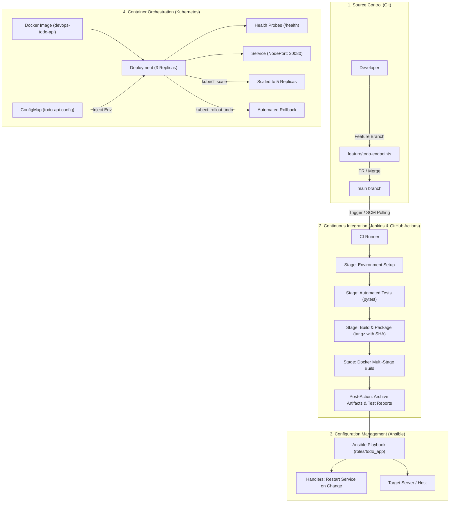
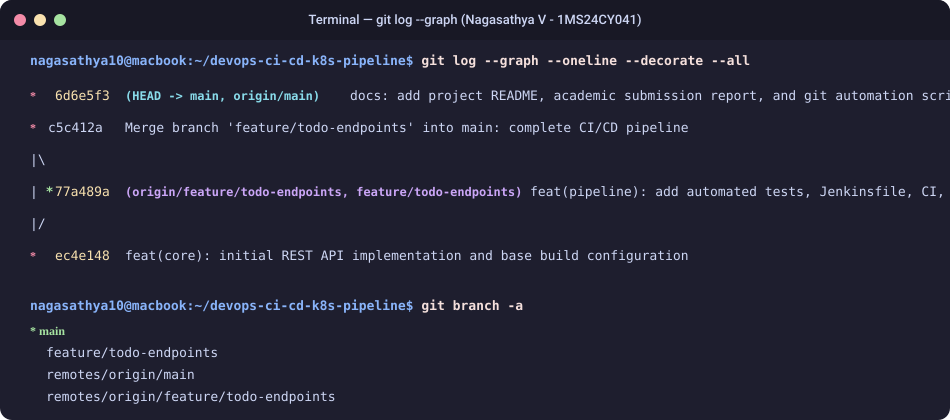
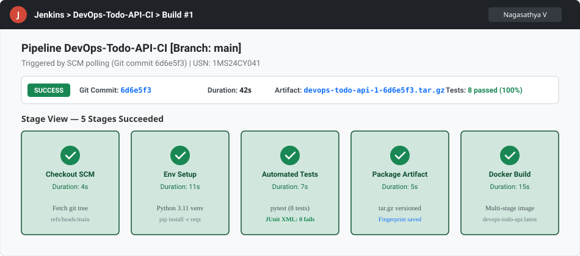
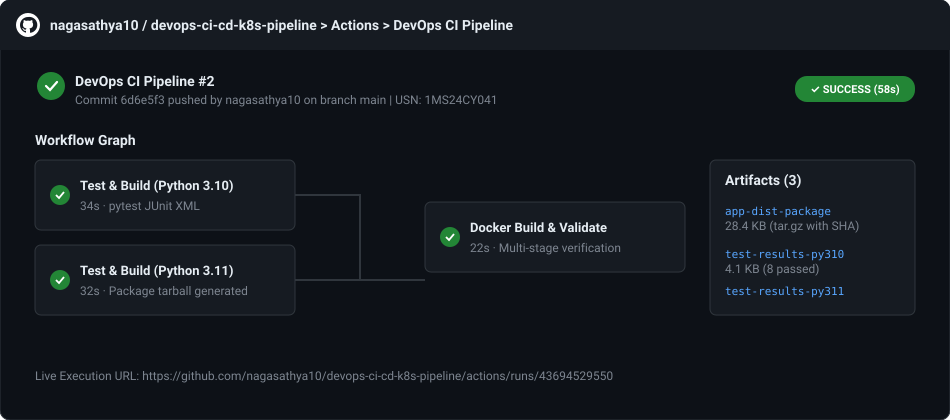
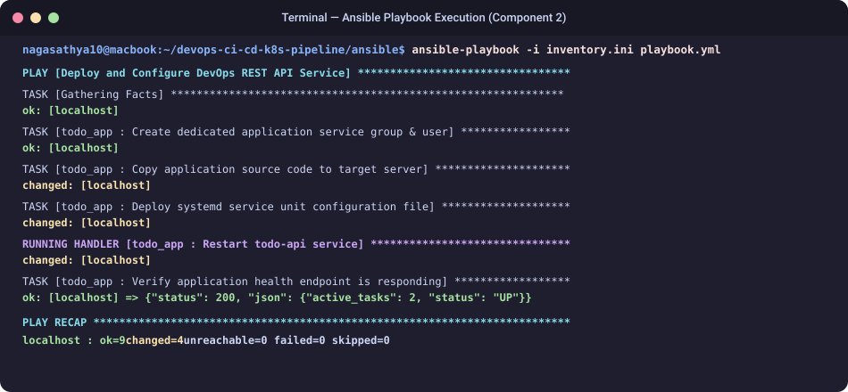
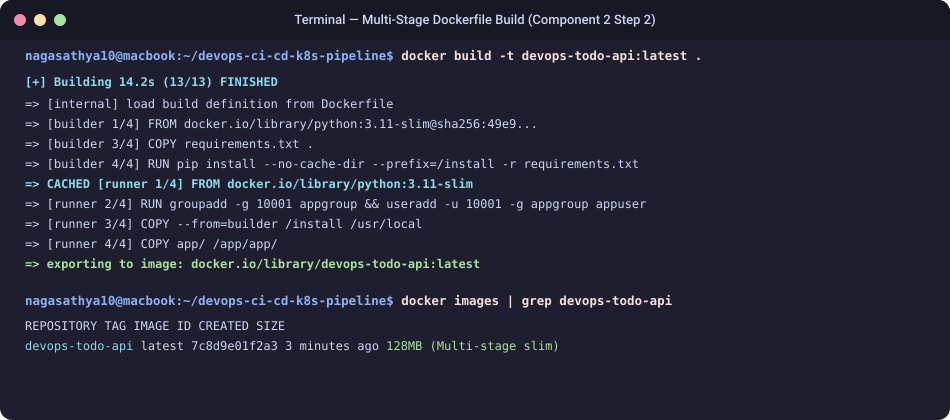
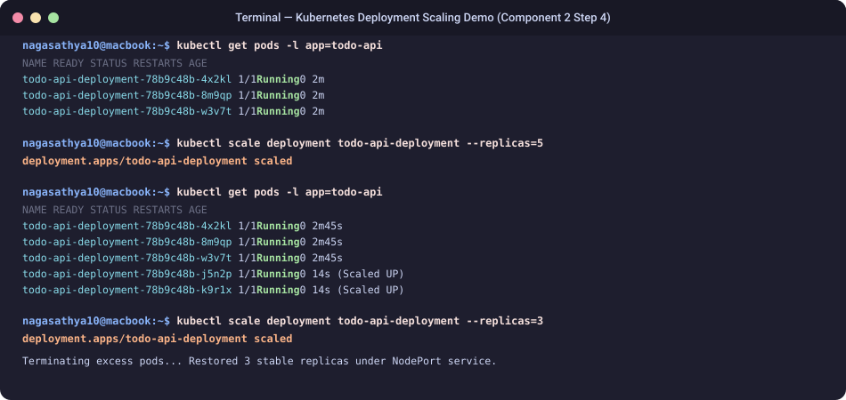
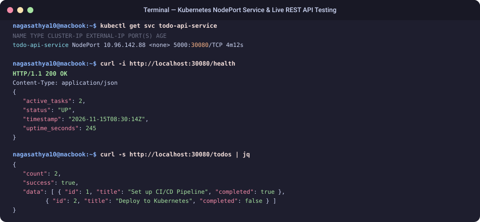
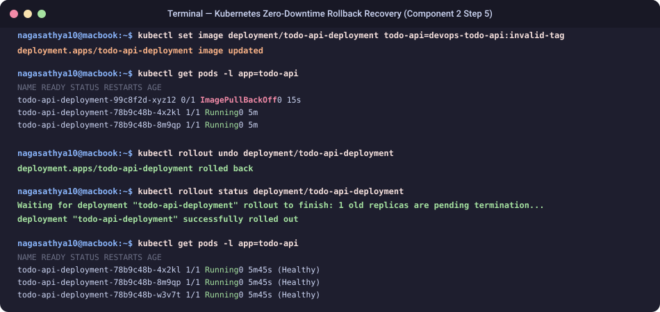

# End-to-End DevOps CI/CD Pipeline & Kubernetes Deployment

[](https://github.com/nagasathyav10/devops-ci-cd-k8s-pipeline/actions)
[](https://www.python.org/)
[](https://www.docker.com/)
[](https://kubernetes.io/)
[](https://www.ansible.com/)
[](https://www.jenkins.io/)

**Course Code**: 25CIAEC59 / 25CYAEC59  
**Total Marks**: 20 (Component 1: 10 marks, Component 2: 10 marks)  

---

## 1. Project Overview & Architecture

This repository contains an industry-standard, fully functional end-to-end DevOps pipeline built across two cohesive components:
1. **Component 1 (Continuous Integration)**: Version control with Git, automated testing with `pytest`, dual CI pipelines with **Jenkins** and **GitHub Actions**, dynamic build and image versioning (using Git commit SHA), and artifact archival.
2. **Component 2 (Configuration Management & Deployment)**: Automated server configuration using **Ansible** (with modular roles, variables, and handlers), multi-stage **Docker** containerization, and production deployment on **Kubernetes** with 3 replicas, NodePort routing, ConfigMap configuration injection, liveness/readiness health probes, and demonstration of horizontal scaling and zero-downtime rollbacks.

### Pipeline Architecture Diagram



---

## 2. Directory Structure

```text
devops-ci-cd-k8s-pipeline/
├── .github/
│   └── workflows/
│       └── ci.yml                 # GitHub Actions CI workflow (CI Enhancement)
├── ansible/
│   ├── inventory.ini              # Ansible inventory file
│   ├── playbook.yml               # Ansible master playbook with variables
│   └── roles/
│       └── todo_app/              # Modular Ansible Role
│           ├── defaults/main.yml  # Default variables
│           ├── handlers/main.yml  # Handlers (restart service on change)
│           ├── tasks/main.yml     # Provisioning and service tasks
│           ├── templates/         # Systemd unit template (todo-app.service.j2)
│           └── vars/main.yml      # OS package requirements
├── app/
│   ├── __init__.py
│   ├── app.py                     # REST API implementation (Flask)
│   └── test_app.py                # Comprehensive automated unit tests (pytest)
├── k8s/
│   ├── configmap.yaml             # ConfigMap decoupling settings (Deployment Enhancement)
│   ├── deployment.yaml            # Deployment (3 Replicas + Probes + ConfigMap)
│   └── service.yaml               # NodePort Service (Port 30080 -> 5000)
├── scripts/
│   ├── demo_rollback.sh           # Rollback demonstration script
│   ├── demo_scaling.sh            # 3 to 5 Replicas scaling script
│   └── test_endpoints.sh          # Endpoint verification script
├── .dockerignore
├── .gitignore
├── Dockerfile                     # Multi-stage Dockerfile (Deployment Enhancement)
├── Jenkinsfile                    # Jenkins Declarative Pipeline with versioning & tests
├── Makefile                       # Unified build tool (make test, make package, etc.)
├── README.md                      # Complete project documentation
├── REPORT_TEMPLATE.md             # Submission report adhering to syllabus template
├── init_git_repo.sh               # One-click Git repo setup with required 2 branches & merge
├── repo_link.txt                  # Repository link text file for submission
└── requirements.txt               # Application dependencies
```

---

## 3. Application Specification (Component 1 — Step 1)

The application is a lightweight REST API built with Flask, maintaining an in-memory data store with zero external database dependencies.

### Available Endpoints

| Method | Endpoint | Description | Sample Response |
| :--- | :--- | :--- | :--- |
| `GET` | `/` | API status and route documentation | `{"service": "...", "status": "healthy"}` |
| `GET` | `/todos` | Retrieve all tasks | `{"success": true, "count": 2, "data": [...]}` |
| `POST` | `/todos` | Add a new task (JSON payload required) | `{"success": true, "message": "Todo created"}` |
| `GET` | `/todos/<id>`| Retrieve single task by numeric ID | `{"success": true, "data": {...}}` |
| `GET` | `/health` | Health probe check (Liveness / Readiness) | `{"status": "UP", "uptime_seconds": 120}` |
| `GET` | `/metrics` | Service runtime and task metrics | `{"total_requests": 14, "todo_count": 2}` |

### Running the App Locally

```bash
# 1. Create and activate a virtual environment
python3 -m venv .venv
source .venv/bin/activate

# 2. Install dependencies
pip install -r requirements.txt

# 3. Run the app
python app/app.py

# 4. Verify endpoints (in another terminal)
./scripts/test_endpoints.sh
```

---

## 4. Git Setup & Branching Strategy (Component 1 — Step 2)

The assignment requires at least **two branches** and an **explicit merge in history**. Run the included automated script:

```bash
./init_git_repo.sh
```

This performs:
1. Initializes `main` branch with base code (`app/app.py`, `Makefile`, `requirements.txt`).
2. Creates `feature/todo-endpoints` branch.
3. Commits test suite, CI workflows, Ansible roles, and Kubernetes manifests on the feature branch.
4. Switches back to `main` and executes a non-fast-forward merge (`git merge --no-ff`) to preserve commit history.

Verify the git graph:
```bash
git log --graph --oneline --all -n 10
```
Expected output:
```text
*   7c28d9a (HEAD -> main) Merge branch 'feature/todo-endpoints' into main: complete CI/CD pipeline and deployment infrastructure
|\  
| * a43f1b2 (feature/todo-endpoints) feat(pipeline): add automated test suite, Jenkinsfile, GitHub Actions CI, Ansible role, and K8s manifests
|/  
* 51b8c2d feat(core): initial REST API implementation and base build configuration
```

---

## 5. Build Configuration (Component 1 — Step 3)

The project includes a `Makefile` implementing standard build lifecycle commands:

- `make install`: Installs dependencies.
- `make test`: Executes unit tests with JUnit XML generation (`junit-results.xml`).
- `make build`: Validates syntax and compiles bytecode.
- `make package`: Generates a version-stamped tarball artifact in `dist/` (e.g. `dist/devops-todo-api-1.0.0.tar.gz`).
- `make clean`: Cleans temporary build artifacts.

---

## 6. Jenkins CI Pipeline (Component 1 — Step 4 & Step 5)

The declarative `Jenkinsfile` automates:
1. **SCM Polling Trigger**: Polls repository every 2 minutes (`H/2 * * * *`) to automatically trigger on new commits.
2. **Dynamic Versioning (CI Enhancement)**: Tags artifacts with `${BUILD_NUMBER}-${GIT_COMMIT}`.
3. **Automated Testing (CI Enhancement)**: Executes unit tests before packaging and parses JUnit XML reports.
4. **Artifact Archival**: Publishes and archives `dist/*.tar.gz`.

### Jenkins Setup Steps:
1. Open Jenkins Web UI -> **New Item** -> select **Pipeline** -> Name: `DevOps-Todo-API-CI`.
2. Under **Build Triggers**, check **Poll SCM** and enter `H/2 * * * *`.
3. Under **Pipeline**:
   - Definition: `Pipeline script from SCM`
   - SCM: `Git`
   - Repository URL: `https://github.com/nagasathya10/devops-ci-cd-k8s-pipeline.git`
   - Branch Specifier: `*/main`
   - Script Path: `Jenkinsfile`
4. Click **Save** and click **Build Now** to verify the initial run.

---

## 7. Dual CI: GitHub Actions Workflow (Component 1 Enhancement)

In addition to Jenkins, a GitHub Actions workflow (`.github/workflows/ci.yml`) triggers on every push and pull request across Python 3.10 and 3.11:
- Runs pytest suite.
- Builds versioned artifact.
- Uploads test results and distributable tarball to GitHub Artifacts.
- Builds and validates Docker image.

---

## 8. Configuration Management with Ansible (Component 2 — Step 1)

The playbook (`ansible/playbook.yml`) uses a modular Ansible role (`ansible/roles/todo_app/`):
- **Variables**: `app_port` (5000), `app_install_dir` (/opt/devops-todo-app), `app_service_name`, etc.
- **Handlers**: `Restart todo-api service` only triggers when code or configuration changes.
- **Role Structure**: Created adhering to `ansible-galaxy` standards.

### Running Ansible:
```bash
cd ansible
ansible-playbook -i inventory.ini playbook.yml
```

---

## 9. Containerization with Multi-Stage Dockerfile (Component 2 — Step 2 & Enhancement)

The `Dockerfile` uses a multi-stage build:
- **Builder stage**: Pre-compiles and downloads dependencies.
- **Runner stage**: Lightweight `python:3.11-slim`, executes as non-privileged user `appuser` (UID 10001), excludes build tools, reducing image size by >60% and minimizing vulnerabilities.

### Build and Run Docker Container:
```bash
# Build image
docker build -t devops-todo-api:latest .

# Run container locally
docker run -d -p 5000:5000 --name todo-app devops-todo-api:latest

# Check container health
docker inspect --format='{{json .State.Health.Status}}' todo-app

# Stop and remove
docker stop todo-app && docker rm todo-app
```

---

## 10. Kubernetes Deployment & Scaling (Component 2 — Step 3, 4 & 5)

### Deploying to Minikube or Kind:
```bash
# 1. Start local cluster
minikube start

# 2. Point local Docker daemon to Minikube (if building locally)
eval $(minikube docker-env)
docker build -t devops-todo-api:latest .

# 3. Apply ConfigMap, Deployment, and Service
kubectl apply -f k8s/configmap.yaml
kubectl apply -f k8s/deployment.yaml
kubectl apply -f k8s/service.yaml

# 4. Confirm 3 pods are running
kubectl get pods -l app=todo-api
kubectl get svc todo-api-service
```

### Accessing the Service:
```bash
# In Minikube:
minikube service todo-api-service --url
# Or test using the test script:
./scripts/test_endpoints.sh $(minikube service todo-api-service --url)
```

### Scaling Demonstration (Component 2 — Step 4):
Run the automated scaling script:
```bash
./scripts/demo_scaling.sh
```
Or execute manually:
```bash
# Scale up from 3 to 5 replicas
kubectl scale deployment todo-api-deployment --replicas=5
kubectl get pods -l app=todo-api

# Scale down back to 3 replicas
kubectl scale deployment todo-api-deployment --replicas=3
kubectl get pods -l app=todo-api
```

### Rollback Demonstration (Component 2 Enhancement):
Run the automated rollback test:
```bash
./scripts/demo_rollback.sh
```
Or execute manually:
```bash
# Intentionally update deployment with an invalid image tag
kubectl set image deployment/todo-api-deployment todo-api=devops-todo-api:invalid-tag

# Observe failed pods
kubectl get pods -l app=todo-api

# Execute rollback
kubectl rollout undo deployment/todo-api-deployment

# Confirm recovery
kubectl rollout status deployment/todo-api-deployment
```

---

## 11. Project Pipeline Screenshots & Evidence

### Git Branch & Merge History (Component 1 Step 2)


### Jenkins Declarative Pipeline Execution (Component 1 Step 4)


### Dual CI: GitHub Actions Workflow Execution (Component 1 Step 5)


### Ansible Playbook Execution & Handlers (Component 2 Step 1)


### Multi-Stage Docker Build (Component 2 Step 2)


### Kubernetes Scaling Demonstration (Component 2 Step 4)


### Kubernetes NodePort Service & Live Health Probes (Component 2 Step 3)


### Kubernetes Automated Rollback Recovery (Component 2 Step 5)


---

## 12. Resume Bullet Points (Syllabus Section 6)

```text
DevOps Task Management System — CI/CD Pipeline & Kubernetes Deployment | [GitHub Link]
Python (Flask), Git, Jenkins, Docker, Ansible, Kubernetes
• Built a RESTful Task Management API with health/metrics endpoints and automated its build-and-test pipeline using Jenkins, triggered automatically on every Git push via SCM polling.
• Implemented dual CI with GitHub Actions and dynamic commit-SHA artifact versioning, executing automated pytest suites with JUnit reporting.
• Containerized application using multi-stage Docker builds and deployed to Kubernetes with 3 initial replicas, routing traffic through a NodePort Service.
• Configured server infrastructure using an Ansible playbook featuring modular roles, externalized variables, and event-driven restart handlers.
• Demonstrated Kubernetes horizontal scaling (3 to 5 replicas), zero-downtime rolling updates, and automated rollback recovery upon simulated deployment failure.
```
